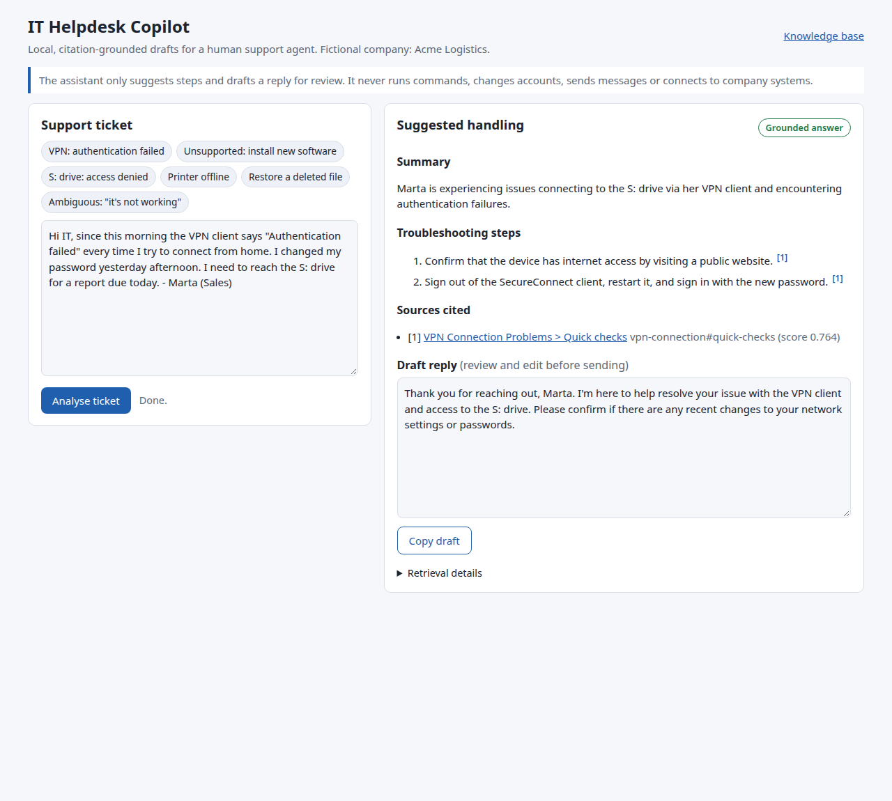
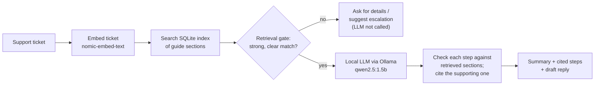

# IT Helpdesk Copilot

A local helpdesk assistant for a fictional small company. A support agent pastes an IT ticket and gets
a short summary, troubleshooting steps grounded in the internal knowledge base with clickable citations,
and a draft reply to review. When the guides do not support an answer, it asks a clarifying question or
suggests escalation instead of guessing.

Everything runs locally with Docker Compose, FastAPI and Ollama on a CPU. No ticket text leaves the machine.



> **Portfolio project with fictional data.** Acme Logistics, its servers, people and tickets are invented.
> The assistant only suggests steps and drafts replies for a human to review. It does not run commands,
> change accounts, send messages or connect to any company system.

## Contents

- [How it works](#how-it-works)
- [Requirements](#requirements)
- [Quick start](#quick-start-docker-compose)
- [Sample tickets](#sample-tickets)
- [Evaluation](#evaluation)
- [Tests](#tests)
- [Configuration](#configuration)
- [Troubleshooting](#troubleshooting)
- [Design choices](#design-choices)
- [Verification status](#verification-status)
- [Five-minute demo script](docs/DEMO.md)

## How it works



More detail: [docs/architecture.md](docs/architecture.md).

**What retrieval does.** Each guide in [`kb/`](kb) is split at its `##` headings into sections with stable
ids such as `vpn-connection#quick-checks`. Sections are embedded locally with `nomic-embed-text` and stored
in a SQLite file. For a ticket, the app embeds the ticket text, scores every section with cosine similarity
and applies three gates:

1. **Low score:** if the best section scores below `MIN_SCORE`, nothing in the knowledge base is close.
2. **No clear match:** if the best section is below `CONFIDENT_SCORE` and the best section of a *different*
   guide is within `AMBIGUITY_MARGIN`, no single guide clearly applies. Vague tickets ("it's not working")
   and requests no guide covers ("install Photoshop") look like this: several guides match weakly and
   almost equally.
3. **Low evidence:** if the ticket shares fewer than `MIN_SHARED_TERMS` concrete words (service names,
   symptoms, error text, devices) with the best guide, the semantic match is not trusted. This catches
   tickets such as "something is weird with my computer", which embeddings can match weakly to any guide.

If a gate triggers, the app returns a clarifying question, an escalation suggestion and a neutral
draft reply, **without calling the LLM**. Otherwise the top sections (at most `TOP_K`, within
`CONTEXT_WINDOW` of the best score) are passed to the model.

**What the LLM does.** The local chat model (`qwen2.5:1.5b` by default) reads the ticket and the retrieved
sections and returns JSON that is constrained by a schema: summary, steps with `source_ids`, a
`needs_more_info` flag with a clarifying question, an escalation flag with a reason, and a draft reply.
The instructions live only in the system prompt. The ticket and the sections are placed in the user message
inside `<ticket>` and `<source id="...">` tags, and their `<`, `>` and `&` characters are escaped, so a ticket
cannot close its tag or pretend to be a source. The prompt tells the model to treat tagged text as data.

**How citations are verified.** The model's `source_ids` are treated as suggestions. For every step the app
measures how much of the step's wording appears in each section that was retrieved *and sent to the model
for this ticket* (share of content words, `MIN_GROUNDING`):

- A suggested id is kept only if it is one of those sections and its text supports the step.
- If the model cited the wrong retrieved section (small models often cite the right guide but the wrong
  section), the step is re-attributed to the retrieved section that supports it best.
- A step that no retrieved section supports is removed, and ids that were never retrieved are discarded.
- If no supported step remains, the answer becomes a clarifying question.

The counts of removed and re-attributed steps are shown under "Retrieval details". Each citation links to
`/kb/<guide>#<section-anchor>`; the guide page renders every section with that same anchor, and the
evaluation and the smoke test open these links to check that the anchor exists. This check is lexical: it
shows that a step restates text from its section, not that the step is the right advice for the ticket.

## Requirements

| Item | Requirement for the default setup |
|---|---|
| Docker | Docker Engine with the Compose v2 plugin (`docker compose version`) |
| CPU | Any x86-64 or ARM64 CPU with AVX2 or NEON. No GPU needed. |
| RAM | About 2.5 GB free for the models (qwen2.5:1.5b about 1.6 GB, nomic-embed-text about 0.5 GB) plus about 0.3 GB for the app. 4 GB free RAM is recommended. |
| Disk | About 1.3 GB for model weights (986 MB + 274 MB), about 0.8 GB for the Ollama image and about 0.3 GB for the app image. Plan for 3 GB. |
| Network | Only for the first start (image and model downloads). |

Answers take roughly 10 to 60 seconds on a laptop CPU, depending on the ticket and the CPU.

## Quick start (Docker Compose)

```bash
git clone https://github.com/saeidptzl/it-helpdesk-copilot.git
cd it-helpdesk-copilot
cp .env.example .env              # optional: every value has a default
docker compose up -d --build      # first start pulls the images and about 1.3 GB of models
docker compose ps                 # wait until "app" is (healthy); model-pull shows "exited (0)"
```

Open <http://127.0.0.1:8000>. The web UI and API are bound to `127.0.0.1` only, and Ollama is not
published to the host at all.

What happens on startup:

1. `ollama` starts and becomes healthy (`ollama list` works).
2. `model-pull` pulls `CHAT_MODEL` and `EMBED_MODEL` into the `ollama-models` volume and exits.
3. `app` starts, builds the search index in the `index-data` volume if it is empty, and becomes healthy
   when `/health` reports that Ollama is reachable, both models are pulled and the index is not empty.

Useful commands:

```bash
curl -s http://127.0.0.1:8000/health                       # status of Ollama, models and index
docker compose exec app python -m app.index --rebuild      # refresh the index after editing kb/*.md
docker compose exec app python -m app.index --status       # sections indexed, model, stale flag
docker compose exec app python -m app.evaluate retrieval   # retrieval-only evaluation
docker compose exec app python -m app.evaluate e2e         # end-to-end evaluation with the real model
python3 scripts/smoke_test.py                              # API smoke test from the host (stdlib only)
docker compose logs -f app                                 # application logs
docker compose down                                        # stop; models and index volumes are kept
```

The `kb/` folder is copied into the image. After editing a guide, run
`docker compose up -d --build` and then the index refresh command above. `/health` reports
`"stale": true` while the index does not match the guides.

## Sample tickets

The web UI has buttons for these samples ([samples/tickets.json](samples/tickets.json)). Two of them are
the reproducible demo cases:

| Case | Ticket | Expected behaviour |
|---|---|---|
| Finds the correct guide | Hi IT, since this morning the VPN client says "Authentication failed" every time I try to connect from home. I changed my password yesterday afternoon. I need to reach the S: drive for a report due today. - Marta (Sales) | Grounded answer citing sections of **VPN Connection Problems** |
| Declines to guess | Please install Adobe Photoshop on my laptop, I need it for a presentation tomorrow morning. Thanks, Luca | **No matching guide**: no steps, no citations, a clarifying question and an escalation suggestion. The LLM is not called. |

## Evaluation

The evaluation set is [eval/eval_set.json](eval/eval_set.json): 28 sample tickets with an expected guide
or an expected "decline" behaviour. It includes a prompt-injection ticket, vague tickets and requests that no
guide covers.

- `dev` (16): used to calibrate every threshold.
- `holdout` (6): written before their first run. They were not used for calibration, but they were seen
  during development, before the shared-terms gate and the step-support check were added.
- `holdout2` (6): written after the last design change and before their first run; never used for tuning.
  This is the most honest estimate of behaviour on new tickets, but six tickets is a very small sample.

Retrieval is tested separately from generation:

```bash
python -m app.evaluate retrieval   # embeddings + gates only, no LLM
python -m app.evaluate e2e         # retrieval + generation + citation checks
```

Latest results with the real local models (2026-11-13, CPU only, run outside Docker; see
[eval/results](eval/results)):

| Check | dev | holdout | holdout2 | Total |
|---|---|---|---|---|
| Retrieval only: correct guide ranked first, or generation blocked for decline cases | 16/16 | 5/6 | 5/6 | 26/28 |
| End to end: correct guide cited (all citations retrieved, anchors exist), or no steps and no citations for decline cases | 16/16 | 6/6 | 5/6 | 27/28 |

What the failures show:

- `ho-dns` (retrieval only): "connected to the VPN but hr.acme.example can't be reached" ranks the VPN guide
  first by 0.002. The DNS guide is still sent to the model, and end to end the answer cites both guides.
- `h2-share` (both): "files in S:\Marketing open as read-only" is a real shared-drive ticket, but the backup
  guide scores within the ambiguity margin, so the assistant asks for details instead of answering.
  It is a safe failure (no wrong advice), but a false decline: `AMBIGUITY_MARGIN` is the weakest threshold.
- Across the 18 answered tickets, the app removed 3 steps that no retrieved section supported and
  corrected the citations of 12 steps that the model had attributed to the wrong section.

Answers take 12 to 27 seconds each on the test laptop's CPU. Declined tickets return in under 0.2 seconds
because the LLM is not called.

## Tests

```bash
pip install -r requirements-dev.txt
pytest -q
```

All `pytest` tests are **mocked**: they use a fake hashing embedder and fake LLM responses, so they run in a
couple of seconds without Ollama. They cover knowledge-base parsing, the SQLite index, both retrieval gates,
citation filtering (invented and unretrieved ids are dropped), prompt separation (a ticket cannot close its
`<ticket>` tag), JSON retry and failure handling, and the API (citation links resolve to section anchors).
Real-model behaviour is covered by `app.evaluate` and `scripts/smoke_test.py`.

## Configuration

Set values in `.env` (see [.env.example](.env.example)) or as environment variables.

| Variable | Default | Meaning |
|---|---|---|
| `CHAT_MODEL` | `qwen2.5:1.5b` | Ollama chat model. `qwen2.5:3b` is more capable but needs about 3 GB RAM and is slower. |
| `EMBED_MODEL` | `nomic-embed-text` | Ollama embedding model. Rebuild the index and re-calibrate after changing it. |
| `EMBED_QUERY_PREFIX` / `EMBED_DOC_PREFIX` | `search_query: ` / `search_document: ` | Task prefixes required by nomic-embed-text. Set both to an empty value for other models. |
| `TOP_K` | `4` | Sections retrieved per ticket. |
| `MIN_SCORE` | `0.60` | Gate 1: minimum similarity of the best section. |
| `CONFIDENT_SCORE` | `0.70` | Gate 2 only applies below this score. |
| `AMBIGUITY_MARGIN` | `0.035` | Gate 2: minimum lead of the best guide over the next guide. |
| `MIN_SHARED_TERMS` | `2` | Gate 3: minimum number of concrete words the ticket shares with the best guide. |
| `CONTEXT_WINDOW` | `0.10` | Sections more than this below the best score are not sent to the model. |
| `MIN_GROUNDING` | `0.35` | Minimum share of a step's content words found in the section it cites. |
| `NUM_CTX` | `4096` | Model context window in tokens. |
| `NUM_PREDICT` / `REPEAT_PENALTY` | `800` / `1.1` | Output cap and repetition penalty (protect against looping output). |
| `LLM_TIMEOUT_S` | `240` | Timeout for one model call. |
| `APP_PORT` | `8000` | Host port, always bound to `127.0.0.1`. |
| `OLLAMA_IMAGE_TAG` | `0.40.16` | Ollama image version. |

## Troubleshooting

**The model is unavailable** (`/health` shows `"ollama unreachable"` or `"model ... is not pulled"`, or the UI
shows an HTTP 503 error):

```bash
docker compose ps                         # is "ollama" healthy? did "model-pull" exit with code 0?
docker compose logs model-pull            # download errors (network, disk space, wrong model name)
docker compose exec ollama ollama list    # models present in the volume
docker compose up -d model-pull           # retry the download
```

If you changed `CHAT_MODEL` or `EMBED_MODEL`, check the exact tag on <https://ollama.com/library>. If the
container is killed while answering, the machine is out of memory: close other programs or keep the
default 1.5B model.

**The index is empty** (`/health` shows `"index is empty"`, or the UI says the index is empty):

```bash
docker compose exec app python -m app.index --rebuild
docker compose exec app python -m app.index --status
```

The app builds the index automatically on first start, but only if the embedding model is available. If
`model-pull` was still running or failed, build the index manually after fixing the model.

**Answers are slow:** the first answer after a start loads the model into memory. `OLLAMA_KEEP_ALIVE=30m`
keeps it loaded. Lower `NUM_CTX` or `TOP_K` for faster answers.

**Port 8000 is in use:** set `APP_PORT=8080` in `.env` and run `docker compose up -d`.

## Running without Docker (development)

```bash
# Ollama installed locally and running on 127.0.0.1:11434
ollama pull qwen2.5:1.5b && ollama pull nomic-embed-text
python3 -m venv .venv && . .venv/bin/activate
pip install -r requirements-dev.txt
python -m app.index --rebuild
python -m app                      # serves http://127.0.0.1:8000
```

## Design choices

**Retrieval implementation.** Section embeddings are stored as float32 blobs in one SQLite file and
searched with exact cosine similarity in NumPy (brute force). For a few hundred sections this takes well
under a millisecond, adds no extra service or native dependency, persists in a Docker volume, and can be
inspected with any SQLite tool. A vector database (Chroma, Qdrant) or FAISS becomes useful only at tens of
thousands of chunks. Exact search also makes the scores reproducible, which the calibrated gates rely on.

**Section-level chunks.** Guides are split at `##` headings, so every citation points to a section a
human can open and read. Each guide has an "Escalation criteria" section that the model can cite.

**Calibration.** All thresholds were chosen from the 16 `dev` tickets with nomic-embed-text and qwen2.5:1.5b.
Shared concrete words separate real and vague tickets clearly (real tickets share 4 or more words with
their guide, vague or unsupported ones 0 or 1). The embedding margins are small, so `AMBIGUITY_MARGIN` is
the most fragile setting: on the second holdout set it declined one genuine ticket (see the results).
Re-run `python -m app.evaluate retrieval` and adjust the thresholds whenever the guides or the models change.

**Why lexical checks next to embeddings.** The embedding search finds related sections; the two lexical
checks (shared terms before generation, step support after generation) are cheap, explainable and catch the
two failure modes observed during development: vague tickets that match every guide a little, and model
steps that invent instructions while citing a real section.

**Small CPU model.** `qwen2.5:1.5b` was chosen because it runs on a laptop CPU in about 2 GB of RAM and
follows JSON schemas reliably. It sometimes gives shorter answers or cites fewer sections than ideal; the
citation check prevents it from citing anything that was not retrieved.

## Verification status

The exact checks, commands and observed results are recorded in
[docs/VERIFICATION.md](docs/VERIFICATION.md). In short:

- **Passed with the real models** (Ollama 0.40.16 on CPU, app run directly on the host): index build,
  retrieval evaluation (26/28), end-to-end evaluation (27/28), API smoke test (7/7), browser check of the UI
  and citation links, and localhost-only network binding.
- **Passed, mocked:** 31 `pytest` tests.
- **Pending:** running the Docker Compose stack itself (health checks, volumes, model-pull job). Docker was
  not available in the build environment. The Compose file was validated against the Compose
  Specification schema, and the commands to complete the check are listed in the verification log.

## Project layout

```
app/            FastAPI app, retrieval, prompts, pipeline, index CLI, evaluation CLI, web UI (app/static)
kb/             Fictional knowledge base: five guides in Markdown
samples/        Sample tickets shown in the UI
eval/           Evaluation set and the latest results
tests/          Mocked pytest suite
scripts/        smoke_test.py for a running instance
docs/           Architecture, demo script, verification log, screenshot
```

## License

MIT. See [LICENSE](LICENSE).
