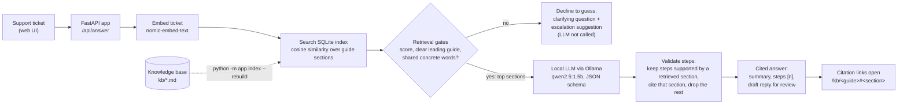

# Architecture

Docker Compose runs three services:

| Service | Image | Purpose | Storage |
|---|---|---|---|
| `ollama` | `ollama/ollama:0.40.16` | Serves the chat and embedding models. Not published to the host. | volume `ollama-models` |
| `model-pull` | `ollama/ollama:0.40.16` | One-shot job that pulls `CHAT_MODEL` and `EMBED_MODEL`. | same volume |
| `app` | built from `Dockerfile` | FastAPI web UI and API on `127.0.0.1:8000`. Builds the index on first start. | volume `index-data` (`/data/index.sqlite3`) |
